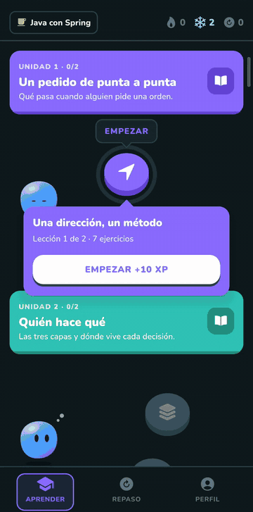
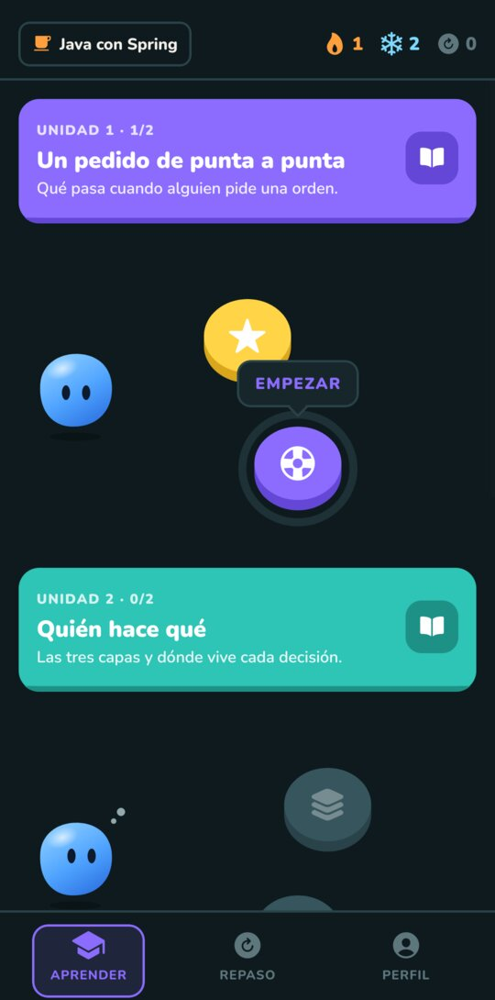
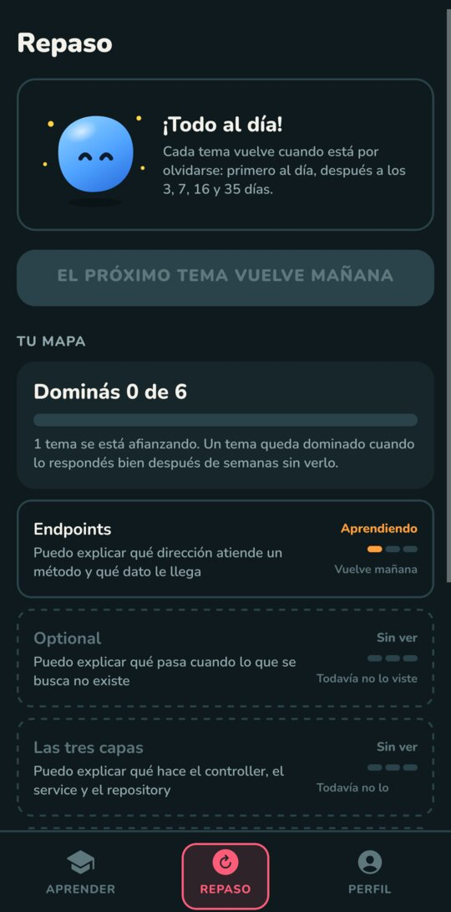
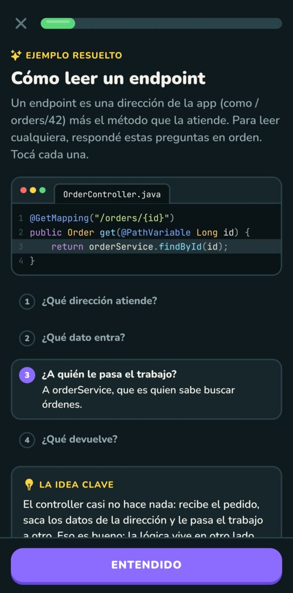
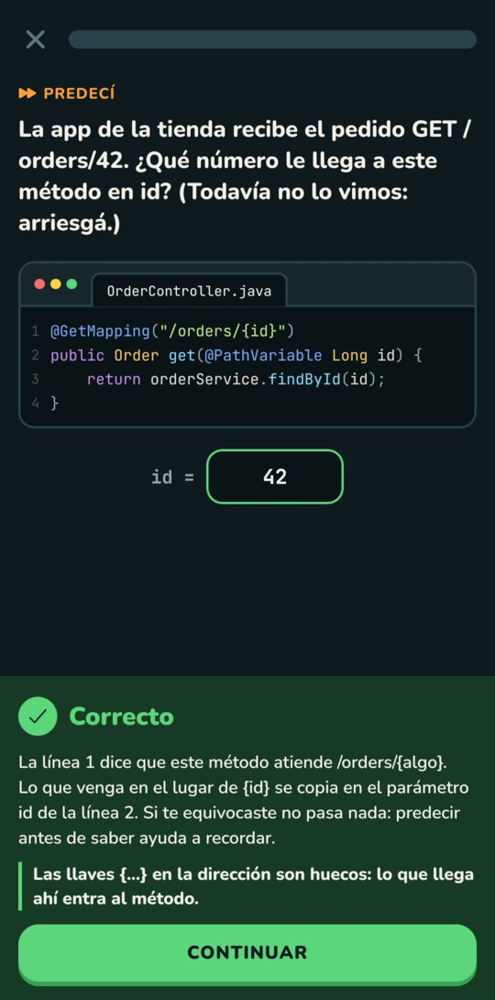
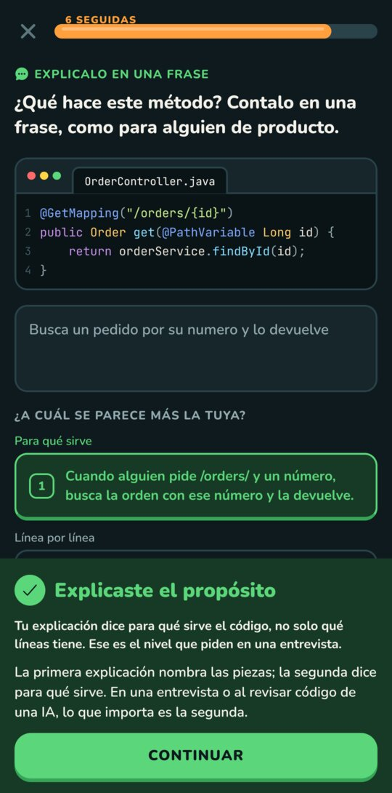
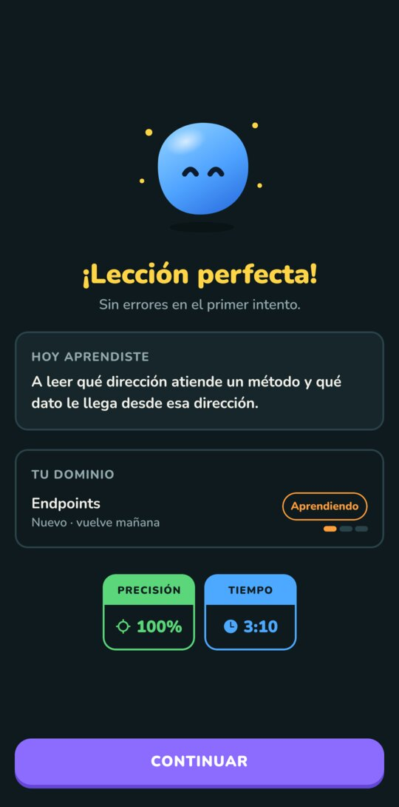

## Recreo

App Android para practicar **lectura de código**, con lecciones cortas estilo Duolingo.

**Stack:** React Native + Expo (SDK 58), TypeScript, Expo Router, Reanimated, react-native-svg
**Plataforma:** Android (APK en Releases); corre también en iOS y web

<p>
  
  
  
</p>

### El problema
Programo mucho con IA y me di cuenta de que había perdido la costumbre de leer código:
aceptaba lo que se generaba sin entenderlo del todo. Las apps para aprender a programar
enseñan a escribir desde cero, no a leer y revisar código que ya existe. Recreo es para eso:
mirar un fragmento real y razonar qué hace, qué pasa en el caso raro y dónde está el error.
También me sirve para ir más tranquilo a entrevistas técnicas, donde lo que piden es
explicar código en voz alta.

### Lo que construí
- Camino de lecciones por unidades, con la lección actual destacada y las siguientes bloqueadas
- 8 tipos de ejercicio: ejemplo resuelto, predecir la salida, tocar la línea, elegir opción, comparar dos versiones, ordenar pasos, completar el hueco y explicar en una frase
- Antes de comprobar, elegís qué tan seguro estás (Seguro / Creo / Adivino); un acierto marcado como "Adivino" vuelve igual en Repaso
- Feedback que explica por qué cada opción incorrecta no era, más el principio para llevarse
- Ejercicio de explicar con autoevaluación: escribís tu frase y la comparás con dos explicaciones modelo, sin IA
- Repaso espaciado por concepto (Leitner: vuelve a los 1, 3, 7, 16 y 35 días), con tope de 6 temas por día
- Repaso intercalado: cada lección termina con hasta 2 temas viejos que tocan ese día
- Dificultad adaptativa dentro de la lección: si venís fallando reaparece el ejemplo resuelto; si venís sobrado se saltean los ejercicios fáciles y se sacan las ayudas visuales
- Mapa de dominio ("Dominás 3 de 6", "Puedo explicar…") en lugar de puntos
- Racha diaria con 2 congeladores automáticos por semana
- Bienvenida de 3 pasos y estados vacíos pensados para quien recién empieza
- Resaltado de sintaxis propio para Java, Kotlin, TypeScript, SQL y YAML
- Todo offline: el progreso se guarda en el teléfono (AsyncStorage)

Las decisiones de diseño (ejemplos resueltos, predecir antes de saber, repaso espaciado,
nada de XP ni vidas) salen de un relevamiento de ciencia del aprendizaje que está en
[`assets/`](assets/). Las lecciones son datos en TypeScript (`src/lessons/courses/`) y se escriben
siguiendo [`src/lessons/AUTHORING.md`](src/lessons/AUTHORING.md); el curso de ejemplo es Java con Spring.

### Screenshots
<p>
  
  
  
  
  
</p>

### Correrlo
```bash
npm install
npx expo start             # abrir con Expo Go o un emulador
npm run android:usb        # teléfono por USB, si la red bloquea el puerto 8081
```

APK de prueba: `npx eas-cli@latest build -p android --profile preview`

---
Contacto: agustinciancio3@gmail.com
